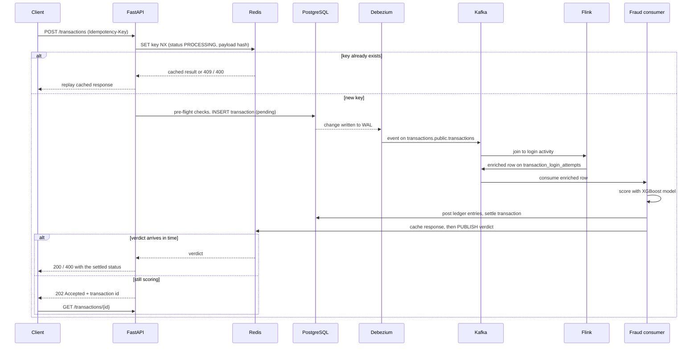

# Banking App Data Architecture

The primary aim of this project is to understand and implement the kind of data architecture behind modern applications that deal with large volumes of data and transactions, such as banking, e-commerce and delivery apps. A secondary aim is to learn how to use AI in data engineering workflows.

I am building it in stages, so some parts of the architecture below are working and some are still planned. The [Project status](#project-status) table shows exactly where things are.

## Contents

- [Banking App Data Architecture](#banking-app-data-architecture)
  - [Contents](#contents)
  - [Project status](#project-status)
  - [Architecture](#architecture)
  - [Transaction lifecycle](#transaction-lifecycle)
  - [Data modelling](#data-modelling)
  - [Change data capture](#change-data-capture)
  - [The lakehouse layers](#the-lakehouse-layers)
  - [Design decisions](#design-decisions)
  - [Fraud detection model](#fraud-detection-model)
  - [Getting started](#getting-started)
    - [Prerequisites](#prerequisites)
    - [1. Set up environment variables](#1-set-up-environment-variables)
    - [2. Add the MinIO license](#2-add-the-minio-license)
    - [3. Start the stack](#3-start-the-stack)
    - [4. Check the connectors and the Flink job](#4-check-the-connectors-and-the-flink-job)
    - [5. Seed some data](#5-seed-some-data)
    - [6. Post a transaction](#6-post-a-transaction)
    - [7. Run dbt](#7-run-dbt)
    - [8. Retrain the fraud model (optional)](#8-retrain-the-fraud-model-optional)
    - [Running the Flink job or consumer on the host](#running-the-flink-job-or-consumer-on-the-host)
  - [Using the API](#using-the-api)
  - [Repo structure](#repo-structure)
  - [Security](#security)
  - [Known gaps](#known-gaps)
  - [Testing, observability and load testing](#testing-observability-and-load-testing)
  - [Using AI in the pipeline](#using-ai-in-the-pipeline)
  - [Deployment](#deployment)

## Project status

| Component | Status | Notes |
| :--- | :--- | :--- |
| FastAPI app: registration, login, JWT auth | ✅ Built | Registration creates the user, an account and the account-holder link. Every login attempt (success or failure) is logged. |
| Transactional schema (PostgreSQL + SQLModel) | ✅ Built | Users, accounts, account holders, login activity, transactions and a double-entry ledger. |
| Redis idempotency layer | ✅ Built | Wired into the `/transactions` endpoint. |
| Transaction processing | ✅ Built | Deposits, withdrawals and transfers post balanced double-entry ledger rows under a row lock, and settle the transaction in the same commit. |
| Alembic migrations | ✅ Built |  A `migrate` service runs `alembic upgrade head` to completion before anything that needs the tables starts.  |
| Debezium CDC into Kafka | ✅ Built | All six tables streamed from the WAL through a publication created by an Alembic revision.  |
| Apache Flink job | ✅ Built | `create_enriched_stream.py` joins login activity to transactions. Runs on a Flink session cluster in Compose and checkpoints every 30 seconds — see [Design decisions](#design-decisions). |
| Fraud detection model | ✅ Trained | XGBoost trained on a synthetic dataset. |
| Fraud scoring consumer | ✅ Built | Scores the enriched stream, settles the transaction and caches the idempotent response. Runs as the `consumers` Compose service and restarts if it dies. |
| MinIO (S3) bronze layer | ✅ Built | MinIO AIStor. A Confluent S3 sink connector writes CDC events to the `bronze` bucket as Snappy-compressed Parquet, partitioned by `event_date`. Verified landing for all six tables. |
| Docker Compose stack | ✅ Built |  |
| pgAdmin | ✅ Built | Server connection and `.pgpass` are generated from `.env` via Compose `configs`, so there is nothing to click through on first run. |
| dbt on DuckDB | 🚧 In progress | dbt reads the bronze Parquet in place from MinIO. All six tables are declared as sources and verified readable; the staging, silver and gold models are still to do. See [The lakehouse layers](#the-lakehouse-layers). |
| Airflow batch pipeline | 📋 Planned | |
| Tests, CI/CD, Terraform, cloud hosting | 📋 Planned | |
| Observability and Locust load testing | 📋 Planned | |
| AI features | 📋 Planned | See [Using AI in the pipeline](#using-ai-in-the-pipeline). |

## Architecture


<!-- TODO: redraw. Flink as a cluster service is accurate again, but the diagram still shows MinIO/dbt as planned and predates the DuckDB decision and the Kafka Connect S3 sink. -->

- **FastAPI app:** An API with endpoints for user registration, login, viewing accounts and initiating banking transactions (deposits, withdrawals and transfers). Endpoints are protected with OAuth2 and JWT tokens. A Locust file will send simulated traffic to the app to test the latency and load handling of the architecture.
- **PostgreSQL:** The transactional (OLTP) database for the app. Runs with `wal_level=logical` so Debezium can read the write-ahead log.
- **Redis cache:** Used to make transactions idempotent. When a transaction comes in, the app checks Redis for the same idempotency key. If it isn't there, the key is locked and the transaction is inserted into Postgres with status `pending`. If a request with the same key and payload arrives again, it is not processed a second time; if the payload has changed under the same key, it is rejected. Once a transaction is processed, the result is cached for 24 hours so retries get the same response straight away. Redis pub/sub is also how the fraud consumer wakes a waiting request.
- **Apache Kafka + Debezium:** This keeps transaction processing from slowing down the app. Debezium reads Postgres' WAL and streams changes to Kafka as an event stream. Kafka runs in KRaft mode, so there is no ZooKeeper.
- **Kafka Connect:** Runs two connectors — the Debezium Postgres source, and a Confluent S3 sink that writes every CDC topic into the MinIO `bronze` bucket. The worker registers both connectors itself on startup, and its health check only passes once both are running.
- **Apache Flink:** Joins login activity to transactions to produce a `login_attempts_last_30min` count per transaction, which is a feature the fraud model needs. The output goes to the `transaction_login_attempts` topic through an `upsert-kafka` sink. The job runs on a Flink session cluster (a jobmanager and a taskmanager) in Compose.
- **Fraud consumer:** Reads the enriched stream, scores each transaction with the XGBoost model, then posts the ledger and settles the transaction. It is the single writer for settlement.
- **MinIO (S3):** The bronze layer of the lakehouse, running the AIStor edition. Raw CDC events land here as Parquet so the analytical side reads from object storage instead of putting load on the transactional database.
- **DuckDB + dbt:** Models bronze into silver and gold. DuckDB reads the bronze Parquet directly out of MinIO over `httpfs`. The sources are in place; the silver and gold models are next.
- **Airflow:** Will orchestrate the batch runs.

## Transaction lifecycle



The API waits a short while for a verdict. If one arrives, it re-reads the transaction row and reports its real status, because the consumer has already committed by the time it publishes. If no verdict arrives, the API returns `202 Accepted` with the transaction id and the client polls `GET /transactions/{id}`. The idempotency lock is deliberately **not** released in that case: the key really is still processing, so a retried `POST` correctly gets a `409` rather than inserting a second transaction for the same intent.

Settlement lives in the consumer rather than the request handler so that a client giving up never leaves a transaction stuck `pending` with nothing to finish it.

## Data modelling

<!--
TODO (Laibah): transactional and analytical database modelling section.


-->

## Change data capture

Debezium reads the WAL through a publication the project creates itself (`publication.autocreate.mode=disabled`), with `SELECT` granted to a dedicated `debezium` replication user on only the tables it needs. Both come from Alembic revision `3e8fc76400cc`.

A few connector settings are load-bearing:

- **`decimal.handling.mode=string`** — money arrives as `"100.00"`, a string. The alternatives are a lossy `double` or an unreadable base64 `bytes`, both of which would undo the point of storing `NUMERIC(18,2)`. The cost is that every analytical model has to cast explicitly.
- **`REPLICA IDENTITY FULL`** on the mutable tables, so an update event carries the complete previous row in `before`. That makes an account's prior balance available for free, instead of only being derivable by replaying the whole ledger. It is not set on `ledger_entries` or `user_accountactivity`, which are append-only, nor on `transactions`, which is the highest-write table and whose status transitions are already recoverable from the ordered event stream.
- **`tombstones.on.delete=false`** — a delete arrives as a single `op: "d"` event with `before` populated, instead of that event plus a separate null-valued tombstone. Paired with `behavior.on.null.values=ignore` on the sink, this is what makes deletes visible in bronze at all.
- **`column.exclude.list=public.users.password_hash`** — password hashes are dropped at the source and never enter Kafka or object storage.
- **`CONNECT_VALUE_CONVERTER_SCHEMAS_ENABLE=true`** on the Connect worker — the S3 sink can only write Parquet when every record carries its schema, so each Kafka message is wrapped as `{"schema": {...}, "payload": {before, after, op, ...}}`. The Flink job reads raw message bytes, so its table definitions go through that `payload` wrapper. Bronze never sees the wrapper, because the sink turns the schema into Parquet columns.

## The lakehouse layers

**Bronze** is the raw CDC event log in MinIO: Snappy-compressed Parquet, a new file per topic every 60 seconds (or every 100,000 records, whichever comes first), Hive-partitioned as `event_date=YYYY-MM-DD`. Each row is the full Debezium envelope, because there is no `ExtractNewRecordState` transform, so `op`, `before`, `after`, `source` and `ts_ms` are top-level columns:

```text
op | before                 | after                    | source            | ts_ms | event_date
u  | {..., balance: "0.00"} | {..., balance: "100.00"} | {lsn, txId, ...}  | ...   | 2026-11-26
```

**Silver** will be built with dbt on DuckDB. DuckDB reads MinIO natively over `httpfs`, so each bronze table is declared as an external source and read in place.

```yaml
sources:
  - name: minio_raw
    tables:
      - name: transactions
        config:
          external_location: "read_parquet('s3://bronze/topics/transactions.public.transactions/event_date=*/*.parquet', hive_partitioning=true, union_by_name=true)"
```

`union_by_name` is there because the sink runs with `schema.compatibility=NONE`, so files written before and after a column change disagree on columns, and the scan would fail without it. The MinIO credentials reach DuckDB through an S3 secret in the project-local `dbt/profiles.yml`. All six sources are declared and verified readable, and `stg_transactions` is a smoke-test view over the raw envelope. The staging, silver and gold models are next.


Two consequences of bronze being an event log rather than a snapshot:

- Current state is a window function, not a `SELECT *` — `row_number() over (partition by id order by ts_us desc) = 1`.
- `op = 'd'` rows have to be kept and projected as a soft-delete flag. Filtering them out in the `WHERE` clause would resurrect a deleted row's last surviving update as live.

**Gold** will be the aggregate tables the AI features query.

## Design decisions

- **Change data capture instead of writing to Kafka from the app.** If the app wrote to Postgres and Kafka separately, one write could succeed and the other fail, leaving the two out of sync. With Debezium reading the WAL, Kafka only ever sees changes that were actually committed to the database.
- **Alembic as the single schema owner.** See [Database migrations](#database-migrations).
- **Two layers of duplicate protection.** Redis catches duplicate requests quickly, before they touch the database. A unique constraint on `(initiated_by, idempotency_key)` in Postgres catches anything that slips through, for example if the Redis key has expired.
- **Hashing the request body.** The idempotency layer stores a SHA-256 hash of the payload with the key. If a client reuses a key with a different body, the request is rejected instead of silently returning the old result.
- **The consumer is the single writer for settlement.** The request handler never posts the ledger itself, even when a verdict arrives while it is still waiting — it re-reads the row instead. Two settlement paths racing on the same transaction is exactly the thing worth avoiding.
- **Named volumes rather than bind mounts.** This reverses an earlier decision. Bind-mounting to `~/banking-app-volumes` kept the Postgres data where I could read it, but it also meant the container inherited host file ownership, and a bind mount hides whatever the image ships at that path. Named volumes pre-populate from the image and are what `docker compose down -v` is scoped to, which makes a deliberate reset a one-liner. The data is still reachable — `docker compose exec` — just not from Finder.

- **Bronze as Parquet rather than JSON.** Parquet is columnar, compressed and typed, so DuckDB reads only the columns a model needs instead of parsing every JSON line. The cost is that the Connect worker has to run with converter schemas enabled — see [Change data capture](#change-data-capture).
- **MinIO AIStor rather than the community image.** MinIO's community edition is source-only now and its public container images were withdrawn. AIStor needs a license file, mounted from `minio/minio.license` (gitignored). The AIStor image ships `mc`, so the `createbuckets` one-shot reuses the same image instead of pulling another one.
- **A separate store for batch analytics.** Batch pipelines read from MinIO rather than the production database, so analytics never competes with live transactions.
- **Least-privilege CDC.** Debezium connects as its own replication user with `SELECT` on only the tables it needs, through a publication I create myself.
- **Kafka in KRaft mode.** Kafka 4 runs without ZooKeeper, so there is one fewer service to run and configure.
- **Saving the model in XGBoost's native format.** The model is saved as JSON rather than pickle, so it isn't tied to the exact library version used to train it. The feature schema is saved alongside it, because new transactions have to be one-hot encoded with the same categories in the same order.

## Fraud detection model

Real fraud data isn't available, so the model is trained on a synthetic dataset of 20,000 transactions generated with Faker and NumPy (`ml/generate_dataset.py`).

- **Features:** transaction amount, transaction type, customer age, occupation and number of login attempts in the last 30 minutes.
- **Label rule:** a transaction is fraud when there is an unusually high number of login attempts (more than 5 in 30 minutes) **and** an unusually high amount (over 5,000). Either one alone is not fraud.
- **Class balance:** about 6% of rows are drawn from an "attack-shaped" pattern (a burst of logins before a large transaction), so there are enough fraud examples to train and evaluate on.
- **Model:** an XGBoost classifier (100 trees, max depth 4) with an 80/20 stratified train/test split (`ml/train_fraud_model.py`).

**Results:**

<!-- TODO: paste the classification report and confusion matrix printed by train_fraud_model.py -->

Because the labels come from a fixed rule, the model should score almost perfectly. That is expected and isn't the point. The focus of this project is the pipeline around the model: getting live features (such as login attempts from Flink) to the consumer, scoring each transaction in real time, and acting on the result.

## Getting started

### Prerequisites

- Docker and Docker Compose
- An AIStor license file for MinIO
- Python 3.14 (the schema uses `uuid.uuid7()` from the standard library), for running the seed script and model training locally
- dbt 2.x with the DuckDB driver installed through `dbc install duckdb` (the driver bundled with dbt can't load the `httpfs` extension)
- Python 3.11, only if you want to run the Flink job on the host — PyFlink does not support 3.14 yet, so it gets its own virtualenv

### 1. Set up environment variables

Create a `.env` file in the project root:

```env
# Postgres
DATABASE_HOSTNAME=localhost
DATABASE_PORT=5433
DATABASE_NAME=banking_app_v2
DATABASE_USERNAME=postgres
DATABASE_PASSWORD=change-me

# JWT
SECRET_KEY=generate-a-long-random-string
ALGORITHM=HS256
ACCESS_TOKEN_EXPIRE_MINUTES=30

# Redis
REDIS_HOST=localhost
REDIS_PORT=6379

# Debezium (the init script creates a user called "debezium")
DEBEZIUM_USER=debezium
DEBEZIUM_PASSWORD=change-me-too

# MinIO
MINIO_ROOT_USER=minioadmin
MINIO_ROOT_PASSWORD=change-me-as-well
```

`DATABASE_PORT=5433` is the **host-side** port, for scripts run on your laptop. Inside the Compose network, `app`, `migrate` and `consumers` override `DATABASE_HOSTNAME` to `postgres` and `DATABASE_PORT` to `5432`, Postgres' real port, and `app` and `consumers` override `REDIS_HOST` to `redis`. Inside a container `localhost` is the container itself, so without those overrides a service fails with `Connection refused` even while Postgres reports it is ready.

### 2. Add the MinIO license

Put your AIStor license at `minio/minio.license`. The `minio` service mounts it, and it is gitignored.

The Confluent S3 sink plugin that Kafka Connect needs is already committed under `kafka/connect/plugins/`, which is the path the `connect` service mounts, so there is nothing to download.

### 3. Start the stack

```bash
docker compose up -d --build
```

Services come up in dependency order through health checks and `service_completed_successfully` gates:

| Service | Starts once |
| :--- | :--- |
| `migrate` | Postgres is healthy |
| `createbuckets` | MinIO is healthy |
| `connect` | Kafka and Postgres are healthy, and `migrate` and `createbuckets` have finished |
| `app` | Postgres and Redis are healthy and `migrate` has finished |
| `consumers` | Postgres, Redis and Kafka are healthy and `migrate` has finished |
| `jobmanager`, `taskmanager` | `flink-dirs-init` has fixed the checkpoint volume ownership |
| `flink-job` | The jobmanager has started, Kafka is healthy, and `connect` is healthy |

`connect` registers both connectors itself on startup and only reports healthy once both are running, which is the gate `flink-job` waits on.

| Service | URL |
| :--- | :--- |
| FastAPI | `http://localhost:8000` (docs at `/docs`) |
| pgAdmin | `http://localhost:5050` |
| MinIO console | `http://localhost:9001` |
| Kafka Connect | `http://localhost:8083` |
| Flink web UI | `http://localhost:8081` |

pgAdmin has its server connection and `.pgpass` generated from `.env` through Compose `configs`, so the `banking_app_v2` database is already there when you open it. Note that the connection uses host `postgres` and port `5432` — the in-network values, not the `5433` your laptop uses.

### 4. Check the connectors and the Flink job

```bash
curl -s localhost:8083/connectors?expand=status
curl -s localhost:8081/jobs/overview
```

Both connectors and their tasks should show `RUNNING`, and so should the Flink job. On a fresh Kafka volume the job shows `RESTARTING` until Debezium has created its input topics. It recovers on its own after the first login and transaction.

### 5. Seed some data

The seed script does **not** create tables — `migrate` has already done that — and it fails with a pointer to `alembic upgrade head` if they are missing.

```bash
python -m venv .venv && source .venv/bin/activate
pip install -r requirements.txt
python seed_data.py
```

This creates the internal clearing account, 8 customers, and 12 accounts with a mix of primary, joint and beneficiary holders. Faker is seeded with a fixed value, so you get the same people and IBANs every time, and the script matches on natural keys so re-running it is a no-op. Every seeded user shares one password, printed at the end.

Seed before posting any transactions: settlement posts against the internal clearing account, and every settlement fails with `NoResultFound` until it exists.

### 6. Post a transaction

Log in, then start a transaction with the token (see [Using the API](#using-the-api)). The transaction goes through Debezium, Flink and the fraud consumer, and settles within a few seconds. Log in *after* the connectors are running: Flink only counts logins Debezium captured as new rows, so a login from before registration doesn't count, and the transaction waits — see [Known gaps](#known-gaps).

### 7. Run dbt

```bash
cd dbt
set -a; source ../.env; set +a   # the DuckDB S3 secret reads MINIO_ROOT_USER and MINIO_ROOT_PASSWORD
dbt run --profiles-dir .
```

The profile is project-local, so `--profiles-dir .` keeps dbt from reading `~/.dbt/profiles.yml`. Bronze files land on a 60-second schedule, so a change from the last minute may not show up yet.

### 8. Retrain the fraud model (optional)

The trained model is committed and baked into the `consumers` image, so this is only needed to retrain:

```bash
pip install -r ml/requirements.txt
python ml/generate_dataset.py
python ml/train_fraud_model.py
docker compose up -d --build consumers
```

This rewrites `ml/models/fraud_model.json` and `ml/models/feature_schema.json`, and the rebuild picks them up.

### Running the Flink job or consumer on the host

Compose runs both, but the host is quicker to iterate on. Stop the Compose copy first so the two don't compete for the same events. The host job's MiniCluster also puts its web UI on port 8081, the same as the Compose jobmanager.

```bash
# Flink job: stopping the jobmanager also ends the job running on the cluster
docker compose stop jobmanager taskmanager
python3.11 -m venv flink/.venv-flink
flink/.venv-flink/bin/pip install "setuptools<81"
flink/.venv-flink/bin/pip install --no-build-isolation -r flink/requirements.txt
flink/.venv-flink/bin/python -m flink.create_enriched_stream

# Fraud consumer
docker compose stop consumers
python kafka/consumers.py
```

## Using the API

| Method | Endpoint | Auth | Description |
| :--- | :--- | :--- | :--- |
| `POST` | `/users` | No | Register a user. Also creates an account and links the user to it. |
| `POST` | `/login` | No | Log in with email and password; returns a JWT access token. |
| `GET` | `/users/accounts` | Yes | List the current user's accounts. |
| `POST` | `/transactions` | Yes | Start a transaction. Needs an `Idempotency-Key` header. |
| `GET` | `/transactions/{id}` | Yes | Poll a transaction's status. |

**Register:**

```bash
curl -X POST http://localhost:8000/users \
  -H "Content-Type: application/json" \
  -d '{"email": "jane@example.com", "password": "a-strong-password", "phone_number": "+447700900123",
       "first_name": "Jane", "last_name": "Doe", "date_of_birth": "1990-05-01", "address": "1 High Street, London"}'
```

**Log in** (OAuth2 password flow, so the email goes in the `username` field):

```bash
curl -X POST http://localhost:8000/login \
  -d "username=jane@example.com&password=a-strong-password"
```

**Start a transaction:**

```bash
curl -X POST http://localhost:8000/transactions \
  -H "Authorization: Bearer <access_token>" \
  -H "Idempotency-Key: 3f1c9a2e-7b4d-4c1a-9e8f-0a1b2c3d4e5f" \
  -H "Content-Type: application/json" \
  -d '{"initiated_by": "<user_id>", "account_id": "<account_id>", "transaction_type": "withdrawal",
       "amount": 50.00, "currency": "USD", "description": "Cash withdrawal"}'
```

Sending the same request again with the same `Idempotency-Key` will not create a second transaction. Reusing the key with a different body returns `400`, and retrying while the first request is still processing returns `409`.

Transfers additionally need `target_account_iban`. Only `deposit`, `withdrawal` and `transfer` are accepted — `fee` and `reversal` were dropped.

## Repo structure

```text
sample_banking_app/
├── app/
│   ├── main.py              # FastAPI app and router wiring
│   ├── database/            # SQLModel schemas, engine and sessions
│   ├── routers/             # users, authentication and transactions endpoints
│   └── utils/               # config, JWT/OAuth2, password hashing, idempotency,
│                            #   ledger posting and settlement helpers
├── alembic/
│   ├── env.py               # builds the URL from app settings; no URL in alembic.ini
│   └── versions/            # four revisions (baseline, txn_type CHECK, replica identity,
│                            #   CDC grants + publication)
├── scripts/
│   └── init_debezium_user.sh  # runs in docker-entrypoint-initdb.d
├── kafka/
│   ├── connect/
│   │   ├── postgres_connector.json    # Debezium source
│   │   ├── minio-connector.json       # Confluent S3 sink (Parquet)
│   │   ├── register-connectors.sh     # runs inside the connect container; globs /connectors/*.json
│   │   └── plugins/                   # Confluent S3 sink plugin
│   ├── consumers.py         # fraud scoring + settlement consumer
│   └── Dockerfile           # consumers image, with the fraud model baked in
├── flink/
│   ├── create_enriched_stream.py  # login-activity join, upsert-kafka sink
│   ├── utils.py                   # builds Debezium envelope DDL from a SQLModel
│   ├── lib/                       # Kafka SQL connector jar
│   └── Dockerfile                 # Flink + PyFlink; shared by jobmanager, taskmanager and flink-job
├── dbt/
│   ├── dbt_project.yml
│   ├── profiles.yml         # project-local DuckDB profile, with the MinIO S3 secret
│   └── models/              # bronze sources and staging; silver/ and gold/ to come
├── minio/
│   └── minio.license        # AIStor license (gitignored)
├── ml/
│   ├── generate_dataset.py  # synthetic fraud dataset
│   ├── train_fraud_model.py # XGBoost training
│   └── models/              # saved model and feature schema
├── seed_data.py             # idempotent reference data (users, accounts, holders)
├── docker-compose.yml
└── Dockerfile
```

## Security

- Passwords are hashed with **PBKDF2-SHA256 (600,000 rounds)** and never stored in plain text.
- Endpoints are protected with **OAuth2 and JWT** access tokens that expire.
- Every login attempt is logged with its outcome, which also feeds the fraud model.
- **`password_hash` is excluded at the CDC source**, so it never reaches Kafka or object storage. Verified: zero occurrences across every bronze object for the `users` topic.
- Secrets live in a `.env` file that is gitignored, and the connectors read their credentials from environment variables rather than from the connector config.
- Debezium uses a **least-privilege replication user** instead of the database owner.
- The app container runs as a **non-root user**.

This is a local learning project, not a hardened deployment. Two things would have to change before it went anywhere real: the pgAdmin password is hardcoded in the committed Compose file, and credentials interpolated into Compose `environment` blocks are visible to anyone who can run `docker inspect`. Real secret management is out of scope for now.

## Known gaps

Things I know are broken or unfinished, so that nobody has to rediscover them:

- **The `debezium_signal` table does not exist.** The connector is configured with `signal.data.collection=public.debezium_signal`, which is what ad-hoc incremental snapshots need. The table was originally created by hand inside the running container, so wiping the Postgres volume took it with it. It should be an Alembic revision so it survives the next reset.
- **`grant_and_publish.sh` swallows psql's exit code.** It echoes success and exits `0` regardless, so a failing statement looks like a clean run to Compose. This already bit once: the first `GRANT` named the missing signalling table, `ON_ERROR_STOP` aborted the whole script, and the publication was silently never created — which killed the Debezium connector with `Publication autocreation is disabled`.
- **Kafka has no persistent volume.** `KAFKA_LOG_DIRS` still points at `/tmp`, and the default 7-day retention means bronze gaps are permanent if the sink is down longer than that.
- **No account ownership check on `POST /transactions`.** `payload.account_id` is never verified against the authenticated user.
- **Nothing reaps transactions left `pending`** when the Flink job or consumer is down.
- **`LedgerEntry.account_iban` has no foreign key** to `accounts.iban`, because entries can be booked against external IBANs this system does not hold.

## Testing, observability and load testing

These are planned:

- **Tests:** unit tests for the idempotency manager and the ledger helpers, and integration tests that run a transaction through the whole pipeline.
- **Observability:** pipeline and consumer metrics with Grafana / OpenTelemetry.
- **Load testing:** a Locust file sending simulated traffic to measure latency and throughput. I will add the results here.

## Using AI in the pipeline

This is the secondary aim of the project and is planned for once the core pipeline is finished:

- **Natural-language questions over metrics:** ask questions in plain English and have them answered from the gold tables.
- **Pipeline failure diagnosis:** an agent that reads pipeline errors, works out the likely cause and suggests a fix as a pull request.

## Deployment

- **Docker:** Every service runs in its own container, orchestrated locally with Docker Compose. Services start in dependency order using health checks and completion gates.
- **Terraform:** Planned, to provision the cloud infrastructure as code.
- **GitHub Actions:** Planned, for running tests and deploying on every push.
- **Cloud hosting:** Planned, on AWS.

