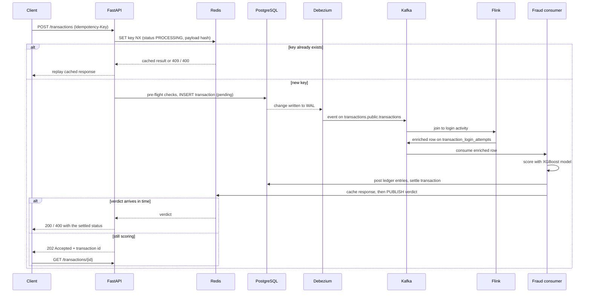

# Banking App Data Architecture

The primary aim of this project is to understand and implement the kind of data architecture behind modern applications that deal with large volumes of data and transactions, such as banking, e-commerce and delivery apps. A secondary aim is to learn how to use AI in data engineering workflows.

I am building it in stages, so some parts of the architecture below are working and some are still planned. The [Project status](#project-status) table shows exactly where things are.

## Contents

- [Project status](#project-status)
- [Architecture](#architecture)
- [Transaction lifecycle](#transaction-lifecycle)
- [Data modelling](#data-modelling)
- [Database migrations](#database-migrations)
- [Change data capture](#change-data-capture)
- [The lakehouse layers](#the-lakehouse-layers)
- [Design decisions](#design-decisions)
- [Fraud detection model](#fraud-detection-model)
- [Getting started](#getting-started)
- [Using the API](#using-the-api)
- [Repo structure](#repo-structure)
- [Security](#security)
- [Known gaps](#known-gaps)
- [Testing, observability and load testing](#testing-observability-and-load-testing)
- [Using AI in the pipeline](#using-ai-in-the-pipeline)
- [Deployment](#deployment)
- [Things I learned along the way](#things-i-learned-along-the-way)

## Project status

| Component | Status | Notes |
| :--- | :--- | :--- |
| FastAPI app: registration, login, JWT auth | ✅ Built | Registration creates the user, an account and the account-holder link. Every login attempt (success or failure) is logged. |
| Transactional schema (PostgreSQL + SQLModel) | ✅ Built | Users, accounts, account holders, login activity, transactions and a double-entry ledger. |
| Redis idempotency layer | ✅ Built | Wired into the `/transactions` endpoint. |
| Transaction processing | ✅ Built | Deposits, withdrawals and transfers post balanced double-entry ledger rows under a row lock, and settle the transaction in the same commit. |
| Alembic migrations | ✅ Built | Three revisions. A `migrate` service runs `alembic upgrade head` to completion before the app starts. Alembic is now the only schema owner — `create_all()` is gone. |
| Debezium CDC into Kafka | ✅ Built | All six tables streamed from the WAL through a self-managed publication. `REPLICA IDENTITY FULL` on the mutable tables, so updates carry a full before-image. |
| MinIO (S3) bronze layer | ✅ Built | A Confluent S3 sink connector writes CDC events to the `bronze` bucket as newline-delimited JSON, partitioned by `event_date`. Verified landing. |
| Fraud detection model | ✅ Trained | XGBoost trained on a synthetic dataset. |
| Fraud scoring consumer | ✅ Built | Scores the enriched stream, settles the transaction and caches the idempotent response. Runs on the host; not dockerized yet. |
| Docker Compose stack | ✅ Built | Postgres, Redis, Kafka, Kafka Connect, MinIO, pgAdmin, the app, and four one-shot init services that run in dependency order. |
| pgAdmin | ✅ Built | Server connection and `.pgpass` are generated from `.env` via Compose `configs`, so there is nothing to click through on first run. |
| Apache Flink job | 🚧 In progress | `create_enriched_stream.py` joins login activity to transactions. Runs in a local MiniCluster rather than a Compose service — see [Design decisions](#design-decisions). |
| Account history endpoint | 🚧 In progress | Returns ledger entries for an account; joins to transactions still to do. |
| dbt silver + gold on DuckDB | 📋 Planned | Bronze will be read in place as a DuckDB external source rather than loaded. See [The lakehouse layers](#the-lakehouse-layers). |
| Airflow batch pipeline | 📋 Planned | |
| Tests, CI/CD, Terraform, cloud hosting | 📋 Planned | |
| Observability and Locust load testing | 📋 Planned | |
| AI features | 📋 Planned | See [Using AI in the pipeline](#using-ai-in-the-pipeline). |

## Architecture


<!-- TODO: redraw. The diagram still shows Flink as a cluster service and MinIO/dbt as planned; it also predates the DuckDB decision and the Kafka Connect S3 sink. -->

- **FastAPI app:** An API with endpoints for user registration, login, viewing accounts and initiating banking transactions (deposits, withdrawals and transfers). Endpoints are protected with OAuth2 and JWT tokens. A Locust file will send simulated traffic to the app to test the latency and load handling of the architecture.
- **PostgreSQL:** The transactional (OLTP) database for the app. Runs with `wal_level=logical` so Debezium can read the write-ahead log.
- **Redis cache:** Used to make transactions idempotent. When a transaction comes in, the app checks Redis for the same idempotency key. If it isn't there, the key is locked and the transaction is inserted into Postgres with status `pending`. If a request with the same key and payload arrives again, it is not processed a second time; if the payload has changed under the same key, it is rejected. Once a transaction is processed, the result is cached for 24 hours so retries get the same response straight away. Redis pub/sub is also how the fraud consumer wakes a waiting request.
- **Apache Kafka + Debezium:** This keeps transaction processing from slowing down the app. Debezium reads Postgres' WAL and streams changes to Kafka as an event stream. Kafka runs in KRaft mode, so there is no ZooKeeper.
- **Kafka Connect:** Runs two connectors — the Debezium Postgres source, and a Confluent S3 sink that writes every CDC topic into the MinIO `bronze` bucket.
- **Apache Flink:** Joins login activity to transactions to produce a `login_attempts_last_30min` count per transaction, which is a feature the fraud model needs. The output goes to the `transaction_login_attempts` topic through an `upsert-kafka` sink.
- **Fraud consumer:** Reads the enriched stream, scores each transaction with the XGBoost model, then posts the ledger and settles the transaction. It is the single writer for settlement.
- **MinIO (S3):** The bronze layer of the lakehouse. Raw CDC events land here so the analytical side reads from object storage instead of putting load on the transactional database.
- **DuckDB + dbt:** Will model bronze into silver and gold. DuckDB reads the bronze JSON directly out of MinIO over `httpfs`.
- **Airflow:** Will orchestrate the batch runs.

## Transaction lifecycle



The API waits a short while for a verdict. If one arrives, it re-reads the transaction row and reports its real status, because the consumer has already committed by the time it publishes. If no verdict arrives, the API returns `202 Accepted` with the transaction id and the client polls `GET /transactions/{id}`. The idempotency lock is deliberately **not** released in that case: the key really is still processing, so a retried `POST` correctly gets a `409` rather than inserting a second transaction for the same intent.

Settlement lives in the consumer rather than the request handler so that a client giving up never leaves a transaction stuck `pending` with nothing to finish it.

## Data modelling

<!--
TODO (Laibah): transactional and analytical database modelling section.

Points you might want to cover from the current schema:
- Tables: users, accounts, account_holders (many-to-many: primary / joint / beneficiary), user_accountactivity, transactions, ledger_entries.
- Double-entry ledger: direction (D/C), amount and balance_after on every entry.
- UUIDv7 primary keys (time-ordered, so inserts stay index-friendly) and a BIGINT identity key on the ledger.
- Money stored as NUMERIC(18,2), never floats.
- CHECK constraints generated from the Python enums, non-negative balances, positive amounts.
- The internal clearing account and why it is exempt from the non-negative balance check.
- Unique (initiated_by, idempotency_key) as a second line of defence behind Redis.
- Composite indexes for the main access patterns (transactions by user/status and time, ledger by account and time).
- No ON DELETE CASCADE on transactions and ledger entries, so the financial record is never lost.
- Deterministic constraint naming for Alembic.
- Analytical side: how the dbt silver / gold layers will be modelled.
-->

One thing worth stating up front, because it shapes the seed script: **`accounts.balance` is not independent data.** It is the running total of that account's ledger entries, maintained under a row lock as each entry is posted. Seeding a non-zero opening balance with no matching ledger rows would make the double-entry invariant false from the first row, so `seed_data.py` opens every account at zero. To fund an account you post a deposit, which moves the balance and the ledger together.

## Database migrations

Alembic owns the schema. The app no longer calls `create_all()` at startup, because two schema owners is worse than one: on a fresh database whichever ran first would build the tables, and if that was `create_all()` there would be no `alembic_version` row, so Alembic would think it was at base and try to create everything again. `create_all()` also only ever `CREATE`s missing tables and never `ALTER`s an existing one — which is how the `transactions.txn_type` CHECK constraint went on accepting `'fee'` and `'reversal'` long after they were dropped from the `TxnType` enum.

The three revisions are:

| Revision | What it does |
| :--- | :--- |
| `f8efcb7a2b73` | Baseline. Generated against an empty database, so it contains full `CREATE TABLE`s and can build the schema from zero. |
| `195721f396f8` | Drops `'fee'` and `'reversal'` from the `txn_type` CHECK constraint — the one real piece of drift the baseline exposed. |
| `07d9e6820274` | Sets `REPLICA IDENTITY FULL` on `accounts`, `users` and `account_holders`. |

Migrations run as their own Compose service:

```yaml
migrate:
  command: ["alembic", "upgrade", "head"]
```

Everything that needs the tables to exist waits on `migrate` with `condition: service_completed_successfully`, so there is no polling and no race. `alembic.ini` deliberately has **no** `sqlalchemy.url`; the URL is built in `alembic/env.py` from the same settings object the app uses, so there is one source of truth and no password in a committed file.

**Adding a revision:**

```bash
.venv/bin/alembic revision --autogenerate -m "what changed"
docker compose up migrate
```

The `alembic/` directory and `alembic.ini` are bind-mounted read-only into the `migrate` service as well as baked into the image, so a new revision does not need an image rebuild during development.

## Change data capture

Debezium reads the WAL through a publication the project creates itself (`publication.autocreate.mode=disabled`), with `SELECT` granted to a dedicated `debezium` replication user on only the tables it needs.

A few connector settings are load-bearing:

- **`decimal.handling.mode=string`** — money arrives as `"100.00"`, a string. The alternatives are a lossy `double` or an unreadable base64 `bytes`, both of which would undo the point of storing `NUMERIC(18,2)`. The cost is that every analytical model has to cast explicitly.
- **`REPLICA IDENTITY FULL`** on the mutable tables, so an update event carries the complete previous row in `before`. That makes an account's prior balance available for free, instead of only being derivable by replaying the whole ledger. It is not set on `ledger_entries` or `user_accountactivity`, which are append-only, nor on `transactions`, which is the highest-write table and whose status transitions are already recoverable from the ordered event stream.
- **`tombstones.on.delete=false`** — a delete arrives as a single `op: "d"` event with `before` populated, instead of that event plus a separate null-valued tombstone. Paired with `behavior.on.null.values=ignore` on the sink, this is what makes deletes visible in bronze at all.
- **`column.exclude.list=public.users.password_hash`** — password hashes are dropped at the source and never enter Kafka or object storage.

## The lakehouse layers

**Bronze** is the raw CDC event log in MinIO: one object per Kafka batch, newline-delimited JSON, Hive-partitioned as `event_date=YYYY-MM-DD`. Records are the full Debezium envelope, because there is no `ExtractNewRecordState` transform:

```json
{"op":"u","before":{...,"balance":"0.00"},"after":{...,"balance":"100.00"},"ts_us":...,"source":{...}}
```

**Silver** will be built with dbt on DuckDB — and deliberately **not** with a dbt Python model. DuckDB reads MinIO natively over `httpfs`, so bronze is declared as an external source and read in place:

```yaml
sources:
  - name: bronze
    meta:
      external_location: "s3://bronze/topics/transactions.public.{name}/*/*.json"
      external_options: { format: newline_delimited, hive_partitioning: true }
```

A Python model would pull bronze into pandas and hand the result back to DuckDB, which costs predicate and projection pushdown and moves the whole scan through Python memory. The transform here is JSON unnesting, casting and dedup — all of it plain SQL. Python models are for what SQL genuinely cannot express.

Two consequences of bronze being an event log rather than a snapshot:

- Current state is a window function, not a `SELECT *` — `row_number() over (partition by id order by ts_us desc) = 1`.
- `op = 'd'` rows have to be kept and projected as a soft-delete flag. Filtering them out in the `WHERE` clause would resurrect a deleted row's last surviving update as live.

**Gold** will be the aggregate tables the AI features query.

## Design decisions

- **Change data capture instead of writing to Kafka from the app.** If the app wrote to Postgres and Kafka separately, one write could succeed and the other fail, leaving the two out of sync. With Debezium reading the WAL, Kafka only ever sees changes that were actually committed to the database.
- **Alembic as the single schema owner.** See [Database migrations](#database-migrations).
- **Two layers of duplicate protection.** Redis catches duplicate requests quickly, before they touch the database. A unique constraint on `(initiated_by, idempotency_key)` in Postgres catches anything that slips through, for example if the Redis key has expired.
- **Hashing the request body.** The idempotency layer stores a SHA-256 hash of the payload with the key. If a client reuses a key with a different body, the request is rejected instead of silently returning the old result.
- **The consumer is the single writer for settlement.** The request handler never posts the ledger itself, even when a verdict arrives while it is still waiting — it re-reads the row instead. Two settlement paths racing on the same transaction is exactly the thing worth avoiding.
- **Named volumes rather than bind mounts.** This reverses an earlier decision. Bind-mounting to `~/banking-app-volumes` kept the Postgres data where I could read it, but it also meant the container inherited host file ownership, and a bind mount hides whatever the image ships at that path. Named volumes pre-populate from the image and are what `docker compose down -v` is scoped to, which makes a deliberate reset a one-liner. The data is still reachable — `docker compose exec` — just not from Finder.
- **Flink runs in a local MiniCluster, not a Compose service.** `create_enriched_stream.py` sets `pipeline.jars` to a local `file://` path. A standalone cluster in Compose would never see that jar, since it lives on the host rather than in the image, and the official Flink image ships no PyFlink — so running it for real would mean building a custom image. The jobmanager and taskmanager services were sitting idle, so they are gone.
- **A separate store for batch analytics.** Batch pipelines read from MinIO rather than the production database, so analytics never competes with live transactions.
- **Least-privilege CDC.** Debezium connects as its own replication user with `SELECT` on only the tables it needs, through a publication I create myself.
- **Kafka in KRaft mode.** Kafka 4 runs without ZooKeeper, so there is one fewer service to run and configure.
- **Saving the model in XGBoost's native format.** The model is saved as JSON rather than pickle, so it isn't tied to the exact library version used to train it. The feature schema is saved alongside it, because new transactions have to be one-hot encoded with the same categories in the same order.

## Fraud detection model

Real fraud data isn't available, so the model is trained on a synthetic dataset of 20,000 transactions generated with Faker and NumPy (`ml/generate_dataset.py`).

- **Features:** transaction amount, transaction type, customer age, occupation and number of login attempts in the last 30 minutes.
- **Label rule:** a transaction is fraud when there is an unusually high number of login attempts (more than 5 in 30 minutes) **and** an unusually high amount (over 5,000). Either one alone is not fraud.
- **Class balance:** about 6% of rows are drawn from an "attack-shaped" pattern (a burst of logins before a large transaction), so there are enough fraud examples to train and evaluate on.
- **Model:** an XGBoost classifier (100 trees, max depth 4) with an 80/20 stratified train/test split (`ml/train_fraud_model.py`).

**Results:**

<!-- TODO: paste the classification report and confusion matrix printed by train_fraud_model.py -->

Because the labels come from a fixed rule, the model should score almost perfectly. That is expected and isn't the point. The focus of this project is the pipeline around the model: getting live features (such as login attempts from Flink) to the consumer, scoring each transaction in real time, and acting on the result.

## Getting started

### Prerequisites

- Docker and Docker Compose
- Python 3.14 (the schema uses `uuid.uuid7()` from the standard library), for running the seed script, consumer and model training locally
- Python 3.11 for the Flink job only — PyFlink does not support 3.14 yet, so it gets its own virtualenv

### 1. Set up environment variables

Create a `.env` file in the project root:

```env
# Postgres
DATABASE_HOSTNAME=localhost
DATABASE_PORT=5433
DATABASE_NAME=banking_app_v2
DATABASE_USERNAME=postgres
DATABASE_PASSWORD=change-me

# JWT
SECRET_KEY=generate-a-long-random-string
ALGORITHM=HS256
ACCESS_TOKEN_EXPIRE_MINUTES=30

# Redis
REDIS_HOST=localhost
REDIS_PORT=6379

# Debezium (the init script creates a user called "debezium")
DEBEZIUM_USER=debezium
DEBEZIUM_PASSWORD=change-me-too

# MinIO
MINIO_ROOT_USER=minioadmin
MINIO_ROOT_PASSWORD=change-me-as-well
```

`DATABASE_PORT=5433` is the **host-side** port, for scripts run on your laptop. Inside the Compose network the app and migrate services override it to `5432`, Postgres' real port, and override `DATABASE_HOSTNAME` to `postgres` and `REDIS_HOST` to `redis`.

### 2. Download the S3 sink connector plugin

Kafka Connect only scans its plugin path at startup, and the Debezium image does not ship the Confluent S3 sink. Extract it to `kafka/connect/plugins/confluentinc-kafka-connect-s3-12.1.15`, which is the path the `connect` service mounts.

### 3. Start the stack

```bash
docker compose up -d --build
```

Services come up in dependency order through health checks and `service_completed_successfully` gates:

```
postgres (healthy) ──► migrate ──► debezium-grants-init ──┐
minio (healthy) ──► create-buckets ──────────────────────┤──► connector-init
kafka (healthy) ──► connect ─────────────────────────────┘
                       migrate ──► app
```

| Service | URL |
| :--- | :--- |
| FastAPI | `http://localhost:8000` (docs at `/docs`) |
| pgAdmin | `http://localhost:5050` |
| MinIO console | `http://localhost:9001` |
| Kafka Connect | `http://localhost:8083` |

pgAdmin has its server connection and `.pgpass` generated from `.env` through Compose `configs`, so the `banking_app_v2` database is already there when you open it. Note that the connection uses host `postgres` and port `5432` — the in-network values, not the `5433` your laptop uses.

### 4. Check the connectors

```bash
curl -s localhost:8083/connectors/postgres-connector/status
curl -s localhost:8083/connectors/minio-sink-connector/status
```

Both the connector and its task should show `RUNNING`.

### 5. Seed some data

The seed script does **not** create tables — `migrate` has already done that — and it fails with a pointer to `alembic upgrade head` if they are missing.

```bash
python -m venv .venv && source .venv/bin/activate
pip install -r requirements.txt
python seed_data.py
```

This creates the internal clearing account, 8 customers, and 12 accounts with a mix of primary, joint and beneficiary holders. Faker is seeded with a fixed value, so you get the same people and IBANs every time, and the script matches on natural keys so re-running it is a no-op. Every seeded user shares one password, printed at the end.

### 6. Run the Flink job

```bash
python3.11 -m venv flink/.venv-flink
flink/.venv-flink/bin/pip install "setuptools<81"
flink/.venv-flink/bin/pip install --no-build-isolation -r flink/requirements.txt
flink/.venv-flink/bin/python -m flink.create_enriched_stream
```

### 7. Run the fraud consumer

```bash
python kafka/consumers.py
```

Create a transaction through the API and you should see it scored and settled.

### 8. Train the fraud model

```bash
pip install -r ml/requirements.txt
python ml/generate_dataset.py
python ml/train_fraud_model.py
```

This writes `ml/models/fraud_model.json` and `ml/models/feature_schema.json`.

## Using the API

| Method | Endpoint | Auth | Description |
| :--- | :--- | :--- | :--- |
| `POST` | `/users` | No | Register a user. Also creates an account and links the user to it. |
| `POST` | `/login` | No | Log in with email and password; returns a JWT access token. |
| `GET` | `/users/accounts` | Yes | List the current user's accounts. |
| `POST` | `/users/account_history/{account_id}` | Yes | Ledger entries for an account (in progress). |
| `POST` | `/transactions` | Yes | Start a transaction. Needs an `Idempotency-Key` header. |
| `GET` | `/transactions/{id}` | Yes | Poll a transaction's status. |

**Register:**

```bash
curl -X POST http://localhost:8000/users \
  -H "Content-Type: application/json" \
  -d '{"email": "jane@example.com", "password": "a-strong-password", "phone_number": "+447700900123",
       "first_name": "Jane", "last_name": "Doe", "date_of_birth": "1990-05-01", "address": "1 High Street, London"}'
```

**Log in** (OAuth2 password flow, so the email goes in the `username` field):

```bash
curl -X POST http://localhost:8000/login \
  -d "username=jane@example.com&password=a-strong-password"
```

**Start a transaction:**

```bash
curl -X POST http://localhost:8000/transactions \
  -H "Authorization: Bearer <access_token>" \
  -H "Idempotency-Key: 3f1c9a2e-7b4d-4c1a-9e8f-0a1b2c3d4e5f" \
  -H "Content-Type: application/json" \
  -d '{"initiated_by": "<user_id>", "account_id": "<account_id>", "transaction_type": "withdrawal",
       "amount": 50.00, "currency": "USD", "description": "Cash withdrawal"}'
```

Sending the same request again with the same `Idempotency-Key` will not create a second transaction. Reusing the key with a different body returns `400`, and retrying while the first request is still processing returns `409`.

Transfers additionally need `target_account_iban`. Only `deposit`, `withdrawal` and `transfer` are accepted — `fee` and `reversal` were dropped.

## Repo structure

```text
sample_banking_app/
├── app/
│   ├── main.py              # FastAPI app and router wiring
│   ├── database/            # SQLModel schemas, engine and sessions
│   ├── routers/             # users, authentication and transactions endpoints
│   └── utils/               # config, JWT/OAuth2, password hashing, idempotency,
│                            #   ledger posting and settlement helpers
├── alembic/
│   ├── env.py               # builds the URL from app settings; no URL in alembic.ini
│   └── versions/            # three revisions (baseline, txn_type CHECK, replica identity)
├── scripts/
│   ├── init_debezium_user.sh  # runs in docker-entrypoint-initdb.d
│   ├── grant_and_publish.sh   # grants + CREATE PUBLICATION, after migrate
│   └── create_buckets.py      # creates the bronze and warehouse buckets
├── kafka/
│   ├── connect/
│   │   ├── postgres_connector.json    # Debezium source
│   │   ├── minio-connector.json       # Confluent S3 sink
│   │   ├── register-connectors.sh     # globs /connectors/*.json
│   │   └── plugins/                   # S3 sink plugin (not committed)
│   └── consumers.py         # fraud scoring + settlement consumer
├── flink/
│   ├── create_enriched_stream.py  # login-activity join, upsert-kafka sink
│   └── utils.py                   # builds Debezium envelope DDL from a SQLModel
├── ml/
│   ├── generate_dataset.py  # synthetic fraud dataset
│   ├── train_fraud_model.py # XGBoost training
│   └── models/              # saved model and feature schema
├── seed_data.py             # idempotent reference data (users, accounts, holders)
├── docker-compose.yml
└── Dockerfile
```

## Security

- Passwords are hashed with **PBKDF2-SHA256 (600,000 rounds)** and never stored in plain text.
- Endpoints are protected with **OAuth2 and JWT** access tokens that expire.
- Every login attempt is logged with its outcome, which also feeds the fraud model.
- **`password_hash` is excluded at the CDC source**, so it never reaches Kafka or object storage. Verified: zero occurrences across every bronze object for the `users` topic.
- Secrets live in a `.env` file that is gitignored, and the connectors read their credentials from environment variables rather than from the connector config.
- Debezium uses a **least-privilege replication user** instead of the database owner.
- The app container runs as a **non-root user**.

This is a local learning project, not a hardened deployment. Two things would have to change before it went anywhere real: the pgAdmin password is hardcoded in the committed Compose file, and credentials interpolated into Compose `environment` blocks are visible to anyone who can run `docker inspect`. Real secret management is out of scope for now.

## Known gaps

Things I know are broken or unfinished, so that nobody has to rediscover them:

- **The `debezium_signal` table does not exist.** The connector is configured with `signal.data.collection=public.debezium_signal`, which is what ad-hoc incremental snapshots need. The table was originally created by hand inside the running container, so wiping the Postgres volume took it with it. It should be an Alembic revision so it survives the next reset.
- **`grant_and_publish.sh` swallows psql's exit code.** It echoes success and exits `0` regardless, so a failing statement looks like a clean run to Compose. This already bit once: the first `GRANT` named the missing signalling table, `ON_ERROR_STOP` aborted the whole script, and the publication was silently never created — which killed the Debezium connector with `Publication autocreation is disabled`.
- **Kafka has no persistent volume.** `KAFKA_LOG_DIRS` still points at `/tmp`, and the default 7-day retention means bronze gaps are permanent if the sink is down longer than that.
- **No account ownership check on `POST /transactions`.** `payload.account_id` is never verified against the authenticated user.
- **Nothing reaps transactions left `pending`** when the Flink job or consumer is down.
- **`LedgerEntry.account_iban` has no foreign key** to `accounts.iban`, because entries can be booked against external IBANs this system does not hold.

## Testing, observability and load testing

These are planned:

- **Tests:** unit tests for the idempotency manager and the ledger helpers, and integration tests that run a transaction through the whole pipeline.
- **Observability:** pipeline and consumer metrics with Grafana / OpenTelemetry.
- **Load testing:** a Locust file sending simulated traffic to measure latency and throughput. I will add the results here.

## Using AI in the pipeline

This is the secondary aim of the project and is planned for once the core pipeline is finished:

- **Natural-language questions over metrics:** ask questions in plain English and have them answered from the gold tables.
- **Pipeline failure diagnosis:** an agent that reads pipeline errors, works out the likely cause and suggests a fix as a pull request.

## Deployment

- **Docker:** Every service runs in its own container, orchestrated locally with Docker Compose. Services start in dependency order using health checks and completion gates.
- **Terraform:** Planned, to provision the cloud infrastructure as code.
- **GitHub Actions:** Planned, for running tests and deploying on every push.
- **Cloud hosting:** Planned, on AWS.

## Things I learned along the way

- **Kafka listeners in Docker.** Containers and the host machine need different listeners. Other containers reach Kafka at `kafka:19092`, while scripts on my laptop use `localhost:9092`. Mixing these up is why Kafka can work from one place and not another, so I kept them separate on purpose. The same split applies to Postgres: `postgres:5432` inside the network, `localhost:5433` outside.
- **Waiting for Kafka Connect properly.** Connect's port opens before its REST API is ready and returns a `404` in the meantime, which `curl`'s own retry treats as success. The registration script retries until it gets a real `201` (or `409` if the connector already exists).
- **Named volumes vs bind mounts, revisited.** My first conclusion was that bind mounts win because the data stays on my own filesystem. What I missed is that a bind mount *hides* whatever the image ships at that path and never copies it, while a named volume pre-populates from the image and inherits its ownership. That matters for Postgres' `PGDATA` and for MinIO's `/data` — MinIO ships no content there, so its named volume comes up root-owned and MinIO dies creating `.minio.sys`. I moved everything to named volumes.
- **Postgres only runs its init scripts on an empty `PGDATA`.** A stale volume from an earlier run meant `docker-entrypoint-initdb.d` was skipped entirely, so the new database and the `debezium` role were never created — and the only symptom was `FATAL: database "banking_app_v2" does not exist`. Worth checking the volume before debugging anything else.
- **Postgres *sources* non-executable `.sh` init scripts** rather than skipping them, so the chmod sidecar I had been running was never needed. Worse, `chmod +x /scripts/*.sh` exits `1` on an empty glob, which failed the sidecar and left Postgres waiting on it forever.
- **Alembic feeds constraint names through the metadata's naming convention.** Passing the fully rendered `ck_transactions_txn_type_valid` to `op.drop_constraint` produced `ck_transactions_ck_transactions_txn_type_valid`. The bare token is what you pass.
- **`include_name` only filters the database reflection side**, not the model side. Keeping a SQLModel class for the signalling table *and* excluding it by name made autogenerate report it as a new table forever, generating a `create_table` that failed with "relation already exists" on every run. Managing it entirely outside the models was the clean answer.
- **A replication slot and a publication are unrelated objects.** The slot holds the position and the WAL retention; the publication is just a catalog filter, passed as an argument at `START_REPLICATION` time. That is why dropping and recreating the publication on every startup doesn't disturb the slot — and why a surviving slot with a lost offset file causes silent data loss rather than an error.
- **JSON escaping through the shell.** Posting a connector config with `-d "$(...)"` collapsed `\\.` to `\.` in a regex, and `\.` is not a legal JSON escape — Connect returned a 500 about an unrecognized character escape, which reads like a connector problem and isn't. Use `--data-binary @file` or a quoted heredoc.
- **Kafka Connect silently ignores unknown config keys.** I spent a while on `tombstone.delete.enabled`, which exists in neither the Debezium nor the S3 sink `ConfigDef` — I was thinking of the JDBC sink's `delete.enabled`. The real keys are `tombstones.on.delete` on the source and `behavior.on.null.values` on the sink. Querying `/connector-plugins/<class>/config` is how to check rather than guess.
- **`timestamp.extractor: RecordField` reads the record value**, so a tombstone — whose value is null by definition — is a guaranteed crash for the S3 sink, not an edge case.
- **Compose interpolation is `${VAR}`, not `{$VAR}`.** The latter expands the variable and leaves the braces as literal text, which turned `"Port": {$DATABASE_PORT}` into `"Port": {5433}` and broke the JSON parse. Compose interpolates `configs` `content:` blocks the same as the rest of the file, which makes generating pgAdmin's `servers.json` and `.pgpass` from `.env` straightforward once the syntax is right.
- **Installing PyFlink.** Its dependency chain still expects `pkg_resources`, which recent `setuptools` versions removed, so `setuptools` has to be pinned below 81 and installed with `--no-build-isolation`.
