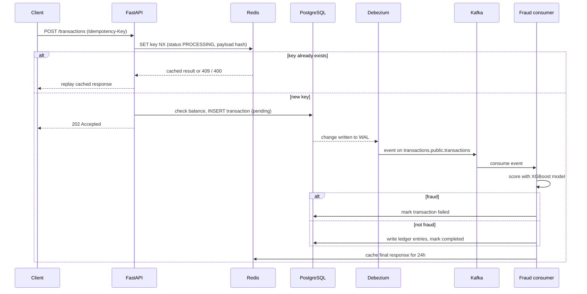

# Banking App Data Architecture

The primary aim of this project is to understand and implement the kind of data architecture behind modern applications that deal with large volumes of data and transactions, such as banking, e-commerce and delivery apps. A secondary aim is to learn how to use AI in data engineering workflows.

I am building it in stages, so some parts of the architecture below are working and some are still planned. The [Project status](#project-status) table shows exactly where things are.

## Contents

- [Project status](#project-status)
- [Architecture](#architecture)
- [Transaction lifecycle](#transaction-lifecycle)
- [Data modelling](#data-modelling)
- [Design decisions](#design-decisions)
- [Fraud detection model](#fraud-detection-model)
- [Getting started](#getting-started)
- [Using the API](#using-the-api)
- [Repo structure](#repo-structure)
- [Security](#security)
- [Testing, observability and load testing](#testing-observability-and-load-testing)
- [Using AI in the pipeline](#using-ai-in-the-pipeline)
- [Deployment](#deployment)
- [Things I learned along the way](#things-i-learned-along-the-way)

## Project status

| Component | Status | Notes |
| :--- | :--- | :--- |
| FastAPI app: registration, login, JWT auth | ✅ Built | Registration creates the user, an account and the account-holder link. Every login attempt (success or failure) is logged. |
| Transactional schema (PostgreSQL + SQLModel) | ✅ Built | Users, accounts, account holders, login activity, transactions and a double-entry ledger. |
| Redis idempotency layer | ✅ Built | Wired into the `/transactions` endpoint. |
| Debezium CDC into Kafka | ✅ Built | Verified that the connector reads the `transactions` table from the WAL. |
| Docker Compose stack | ✅ Built | Postgres, Redis, Kafka, Debezium, Flink and the app. |
| Fraud detection model | ✅ Trained | XGBoost trained on a synthetic dataset. Not yet connected to the consumer. |
| Transaction processing | 🚧 In progress | Pending transactions are inserted with a balance check. Ledger entries and status updates are still to do. |
| Kafka consumer | 🚧 In progress | Currently reads and prints CDC events. Fraud scoring and writing to storage are next. |
| Apache Flink jobs | 🚧 In progress | Flink cluster runs in Docker Compose; the login and daily aggregate jobs are not written yet. |
| Account history endpoint | 🚧 In progress | Returns ledger entries for an account; joins to transactions still to do. |
| Alembic migrations | 📋 Planned | The schema already uses deterministic constraint names so autogenerated migrations stay clean. |
| MinIO (S3) cold storage | 📋 Planned | |
| Airflow batch pipeline | 📋 Planned | |
| dbt analytical warehouse | 📋 Planned | |
| Tests, CI/CD, Terraform, cloud hosting | 📋 Planned | |
| Observability and Locust load testing | 📋 Planned | |
| AI features | 📋 Planned | See [Using AI in the pipeline](#using-ai-in-the-pipeline). |

## Architecture


<!-- TODO: redraw planned components (MinIO, Airflow, dbt, warehouse) with dashed lines so the diagram matches the status table. -->

- **FastAPI app:** An API with endpoints for user registration, login, viewing accounts and initiating banking transactions (deposits, withdrawals, transfers, fees and reversals). Endpoints are protected with OAuth2 and JWT tokens. A Locust file will send simulated traffic to the app to test the latency and load handling of the architecture.
- **PostgreSQL:** The transactional (OLTP) database for the app.
- **Redis cache:** Used to make transactions idempotent. When a transaction comes in, the app checks Redis for the same idempotency key. If it isn't there, the key is locked and the transaction is inserted into Postgres with status `pending`. If a request with the same key and payload arrives again, it is not processed a second time; if the payload has changed under the same key, it is rejected. Once a transaction is processed, the result is cached for 24 hours so retries get the same response straight away.
- **Apache Kafka + Debezium:** This keeps transaction processing from slowing down the app. Debezium reads Postgres' write-ahead log (WAL) and streams changes to Kafka as an event stream. Kafka consumers will then run each transaction through the fraud detection model (fraudulent transactions are cancelled), feed Flink for real-time analytics, and write transactions to MinIO (S3) storage.
- **Apache Flink:** Will keep daily metric aggregates for real-time analytics, and aggregate successful and failed login attempts per user. The login aggregates are a feature the fraud model needs.
- **MinIO (S3):** Cold storage for transaction data, so the batch pipeline reads from storage instead of putting load on the transactional database.
- **Airflow:** Will orchestrate batch pipelines that load data from S3 into the analytical warehouse.
- **dbt:** Will model the data and build the schema for the analytical warehouse.

## Transaction lifecycle

This is the target flow for a transaction once processing is finished. Steps up to the Kafka event work today; the consumer steps are in progress.



The API returns `202 Accepted` rather than `200 OK` because the transaction is accepted for processing, not finished. The client can check the result by retrying with the same idempotency key, which returns the cached outcome once it is ready.

## Data modelling

<!--
TODO (Laibah): transactional and analytical database modelling section.

Points you might want to cover from the current schema:
- Tables: users, accounts, account_holders (many-to-many: primary / joint / beneficiary), user_accountactivity, transactions, ledger_entries.
- Double-entry ledger: direction (D/C), amount and balance_after on every entry.
- UUIDv7 primary keys (time-ordered, so inserts stay index-friendly) and a BIGINT identity key on the ledger.
- Money stored as NUMERIC(18,2), never floats.
- CHECK constraints generated from the Python enums, non-negative balances, positive amounts.
- Unique (initiated_by, idempotency_key) as a second line of defence behind Redis.
- Composite indexes for the main access patterns (transactions by user/status and time, ledger by account and time).
- No ON DELETE CASCADE on transactions and ledger entries, so the financial record is never lost.
- Deterministic constraint naming for Alembic.
- Analytical side: how the dbt bronze / silver / gold layers will be modelled.
-->

## Design decisions

- **Change data capture instead of writing to Kafka from the app.** If the app wrote to Postgres and Kafka separately, one write could succeed and the other fail, leaving the two out of sync. With Debezium reading the WAL, Kafka only ever sees changes that were actually committed to the database.
- **Two layers of duplicate protection.** Redis catches duplicate requests quickly, before they touch the database. A unique constraint on `(initiated_by, idempotency_key)` in Postgres catches anything that slips through, for example if the Redis key has expired.
- **Hashing the request body.** The idempotency layer stores a SHA-256 hash of the payload with the key. If a client reuses a key with a different body, the request is rejected instead of silently returning the old result.
- **Asynchronous processing.** Fraud scoring and ledger writes happen in Kafka consumers, so a slow model or a burst of traffic doesn't hold up the API.
- **A separate store for batch analytics.** Batch pipelines will read from MinIO rather than the production database, so analytics never competes with live transactions.
- **Least-privilege CDC.** Debezium connects as its own replication user with `SELECT` on only the tables it needs, through a publication I create myself (`publication.autocreate.mode` is disabled).
- **Kafka in KRaft mode.** Kafka 4 runs without ZooKeeper, so there is one fewer service to run and configure.
- **Saving the model in XGBoost's native format.** The model is saved as JSON rather than pickle, so it isn't tied to the exact library version used to train it. The feature schema is saved alongside it, because new transactions have to be one-hot encoded with the same categories in the same order.

## Fraud detection model

Real fraud data isn't available, so the model is trained on a synthetic dataset of 20,000 transactions generated with Faker and NumPy (`ml/generate_dataset.py`).

- **Features:** transaction amount, transaction type, customer age, occupation and number of login attempts in the last 30 minutes.
- **Label rule:** a transaction is fraud when there is an unusually high number of login attempts (more than 5 in 30 minutes) **and** an unusually high amount (over 5,000). Either one alone is not fraud.
- **Class balance:** about 6% of rows are drawn from an "attack-shaped" pattern (a burst of logins before a large transaction), so there are enough fraud examples to train and evaluate on.
- **Model:** an XGBoost classifier (100 trees, max depth 4) with an 80/20 stratified train/test split (`ml/train_fraud_model.py`).

**Results:**

<!-- TODO: paste the classification report and confusion matrix printed by train_fraud_model.py -->

Because the labels come from a fixed rule, the model should score almost perfectly. That is expected and isn't the point. The focus of this project is the pipeline around the model: getting live features (such as login attempts from Flink) to the consumer, scoring each transaction in real time, and acting on the result.

## Getting started

### Prerequisites

- Docker and Docker Compose
- Python 3.14 (the schema uses `uuid.uuid7()` from the standard library), for running the seed script, consumer and model training locally

### 1. Set up environment variables

Copy the example file and fill in your own values:

```bash
cp .env.example .env
```

```env
# Postgres
DATABASE_HOSTNAME=localhost
DATABASE_PORT=5433
DATABASE_NAME=banking
DATABASE_USERNAME=postgres
DATABASE_PASSWORD=change-me

# JWT
SECRET_KEY=generate-a-long-random-string
ALGORITHM=HS256
ACCESS_TOKEN_EXPIRE_MINUTES=30

# Redis
REDIS_HOST=localhost
REDIS_PORT=6379

# Debezium (the init script creates a user called "debezium")
DEBEZIUM_USER=debezium
DEBEZIUM_PASSWORD=change-me-too
```

Inside Docker, the app overrides `DATABASE_HOSTNAME` and `REDIS_HOST` to point at the `postgres` and `redis` containers.

### 2. Start the stack

```bash
docker compose up -d --build
```

This starts Postgres (with logical replication enabled), Redis, Kafka, Debezium, Flink and the app, and registers the Debezium connector automatically. Postgres data is bind-mounted to `~/banking-app-volumes/postgres_data` so it survives `docker compose down`.

The API is available at `http://localhost:8000`, with interactive docs at `http://localhost:8000/docs`. The Flink dashboard is at `http://localhost:8081`.

### 3. Check the Debezium connector

```bash
curl http://localhost:8083/connectors/postgres-connector/status
```

Both the connector and its task should show `RUNNING`.

### 4. Seed some data

```bash
python -m venv .venv && source .venv/bin/activate
pip install -r requirements.txt
python seed_data.py
```

### 5. Watch CDC events

```bash
python kafka/consumers.py
```

Create a transaction through the API and you should see the change event printed.

### 6. Train the fraud model

```bash
pip install -r ml/requirements.txt
python ml/generate_dataset.py
python ml/train_fraud_model.py
```

This writes `ml/models/fraud_model.json` and `ml/models/feature_schema.json`.

## Using the API

| Method | Endpoint | Auth | Description |
| :--- | :--- | :--- | :--- |
| `POST` | `/users` | No | Register a user. Also creates an account and links the user to it. |
| `POST` | `/login` | No | Log in with email and password; returns a JWT access token. |
| `GET` | `/users/accounts` | Yes | List the current user's accounts. |
| `POST` | `/users/account_history/{account_id}` | Yes | Ledger entries for an account (in progress). |
| `POST` | `/transactions` | Yes | Start a transaction. Needs an `Idempotency-Key` header. |

**Register:**

```bash
curl -X POST http://localhost:8000/users \
  -H "Content-Type: application/json" \
  -d '{"email": "jane@example.com", "password": "a-strong-password", "phone_number": "+447700900123",
       "first_name": "Jane", "last_name": "Doe", "date_of_birth": "1990-05-01", "address": "1 High Street, London"}'
```

**Log in** (OAuth2 password flow, so the email goes in the `username` field):

```bash
curl -X POST http://localhost:8000/login \
  -d "username=jane@example.com&password=a-strong-password"
```

**Start a transaction:**

```bash
curl -X POST http://localhost:8000/transactions \
  -H "Authorization: Bearer <access_token>" \
  -H "Idempotency-Key: 3f1c9a2e-7b4d-4c1a-9e8f-0a1b2c3d4e5f" \
  -H "Content-Type: application/json" \
  -d '{"initiated_by": "<user_id>", "account_id": "<account_id>", "transaction_type": "withdrawal",
       "amount": 50.00, "currency": "USD", "description": "Cash withdrawal"}'
```

Sending the same request again with the same `Idempotency-Key` will not create a second transaction. Reusing the key with a different body returns `400`, and retrying while the first request is still processing returns `409`.

## Repo structure

```text
sample_banking_app/
├── app/
│   ├── main.py              # FastAPI app and startup
│   ├── database/            # SQLModel schemas, engine and sessions
│   ├── routers/             # users, authentication and transactions endpoints
│   └── utils/               # config, JWT/OAuth2, password hashing, idempotency manager
├── init-postgres/           # creates the Debezium replication user and publication
├── kafka/
│   ├── connect/             # Debezium connector config and registration script
│   └── consumers.py         # CDC event consumer
├── flink/                   # Flink jobs (in progress)
├── ml/
│   ├── generate_dataset.py  # synthetic fraud dataset
│   ├── train_fraud_model.py # XGBoost training
│   └── models/              # saved model and feature schema
├── seed_data.py             # fake users and accounts with Faker
├── docker-compose.yml
└── Dockerfile
```

## Security

- Passwords are hashed with **PBKDF2-SHA256 (600,000 rounds)** and never stored in plain text.
- Endpoints are protected with **OAuth2 and JWT** access tokens that expire.
- Every login attempt is logged with its outcome, which also feeds the fraud model.
- Secrets live in a `.env` file that is gitignored, and Debezium reads its credentials from environment variables rather than the connector config.
- Debezium uses a **least-privilege replication user** instead of the database owner.
- The app container runs as a **non-root user**.

## Testing, observability and load testing

These are planned:

- **Tests:** unit tests for the idempotency manager and helpers, and integration tests that run a transaction through the whole pipeline.
- **Observability:** pipeline and consumer metrics with Grafana / OpenTelemetry.
- **Load testing:** a Locust file sending simulated traffic to measure latency and throughput. I will add the results here.

## Using AI in the pipeline

This is the secondary aim of the project and is planned for once the core pipeline is finished:

- **Natural-language questions over metrics:** ask questions in plain English and have them answered from the gold tables in the analytical warehouse.
- **Pipeline failure diagnosis:** an agent that reads pipeline errors, works out the likely cause and suggests a fix as a pull request.

## Deployment

- **Docker:** Every service runs in its own container, orchestrated locally with Docker Compose. Services start in dependency order using health checks.
- **Terraform:** Planned, to provision the cloud infrastructure as code.
- **GitHub Actions:** Planned, for running tests and deploying on every push.
- **Cloud hosting:** Planned, on AWS.

## Things I learned along the way

- **Kafka listeners in Docker.** Containers and the host machine need different listeners. Other containers reach Kafka at `kafka:19092`, while scripts on my laptop use `localhost:9092`. Mixing these up is why Kafka can work from one place and not another, so I kept them separate on purpose.
- **Waiting for Kafka Connect properly.** Connect's port opens before its REST API is ready and returns a `404` in the meantime, which `curl`'s own retry treats as success. The registration script retries until it gets a real `201` (or `409` if the connector already exists).
- **Docker volumes vs bind mounts.** A named volume persists data, but on Docker's Linux VM where I can't easily get to it. Bind-mounting a local folder keeps the Postgres data on my own filesystem.
- **Installing PyFlink.** Its dependency chain still expects `pkg_resources`, which recent `setuptools` versions removed, so `setuptools` has to be pinned below 81 and installed with `--no-build-isolation`.
